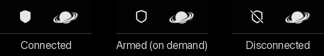
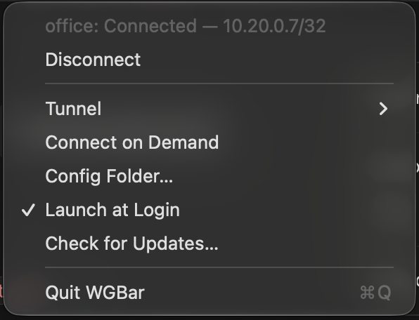

# WGBar




A tiny macOS menu bar toggle for WireGuard tunnels managed by `wg-quick`
(the Homebrew `wireguard-tools` package).

- **Left-click** the shield icon to connect / disconnect.
- **Right-click** for a menu: status and tunnel address, connect/disconnect,
  pick a tunnel (when you have more than one), connect on demand, launch at login, check for
  updates, quit.
- Icon: `shield.fill` = connected, `shield` = armed (on demand), `shield.slash` = disconnected.



It is about 2,900 lines of Rust that use the objc2 Cocoa bindings and `libc` (`./test.sh` runs the
unit tests and the helper tests). It exists because the App Store WireGuard app uses its own tunnel stack (not your `wg-quick` configs), and
the other menu bar options are unmaintained.

Beyond the toggle, it solves three things the stock tooling gets wrong on macOS:

- **[Connect on demand](#connect-on-demand)** — the tunnel comes up when something opens a
  connection into it and goes down when idle, *without the first connection failing*. Done by
  keeping the WireGuard interface "armed" (up, routed, silent while idle) so sockets bind the
  tunnel address before the handshake exists; the first packet starts the handshake.
- **[DNS repair](#dns-left-behind-and-the-fix)** — `wg-quick` leaves VPN DNS servers set system-wide
  when its monitor dies; WGBar detects and reverts that at launch, on wake and on network changes.
- **[Least-privilege root](#optional-toggle-without-a-password-prompt)** — a small root helper plus a
  `sudoers.d` rule scoped to your user and the config files that exist, validated with `visudo -c`.
  Falls back to the standard admin dialog if not installed.

## Requirements

- macOS 13 Ventura or newer (Apple silicon or Intel).
- Rust, installed with rustup: `curl --proto '=https' --tlsv1.2 -sSf https://sh.rustup.rs | sh`
- Xcode Command Line Tools: `xcode-select --install` (the linker and `codesign` come from them)
- WireGuard tools from Homebrew: `brew install wireguard-tools`
- At least one tunnel config (`<name>.conf`) in one of the folders WGBar searches:
  `/opt/homebrew/etc/wireguard`, `/usr/local/etc/wireguard`, `/opt/local/etc/wireguard`
  (MacPorts) or `/etc/wireguard` — or anywhere else, chosen via **Config Folder…**
  (see below). If `wg-quick up <name>` works in Terminal, WGBar will work.

## Install

```sh
git clone https://github.com/Nikohtr/wgbar.git wgbar
cd wgbar
./install.sh
```

`install.sh` builds the app with cargo (through `build.sh`), copies it to `~/Applications/WGBar.app`, and launches it.
On first launch it registers itself as a login item; untick **Launch at Login** in the
menu if you don't want that.

The app is built on your machine and ad-hoc signed, so there is no Gatekeeper prompt.
(There is no notarized download because that requires a paid Apple Developer ID.)

### Optional: toggle without a password prompt

`wg-quick` needs root. By default WGBar shows the standard macOS administrator dialog
(Touch ID works there). To skip the prompt entirely:

```sh
./sudoers.sh
```

This compiles the Rust helper (`target/release/wgbar-helper`) with the config folder and the
`wg-quick` paths baked in at build time, installs it to `/usr/local/libexec/wgbar-helper`, and
writes `/etc/sudoers.d/wgbar` allowing **only your user** to run the helper and
`wg-quick up/down <path-to-config>` for the tunnel configs that exist right now, after
validating it with `visudo -c`. It refuses config files your user cannot already read.
Re-run it after adding a config, changing the config folder, or updating WGBar
(`./sudoers.sh /some/other/folder` to point it elsewhere). Remove it with
`sudo rm /etc/sudoers.d/wgbar /usr/local/libexec/wgbar-helper`.

## Choosing a tunnel

WGBar picks the first config alphabetically. With more than one config a **Tunnel ▸**
submenu appears in the right-click menu; the choice is remembered in
`defaults read org.wgbar.WGBar tunnel`.

## Config folder and unusual setups

WGBar uses the first of `/opt/homebrew/etc/wireguard`, `/usr/local/etc/wireguard`,
`/opt/local/etc/wireguard`, `/etc/wireguard` that contains `.conf` files. If yours live
somewhere else, right-click → **Config Folder…** and pick it (hover the item to see the
folder currently in use). The folder must be listable by your user; WGBar hands
`wg-quick` the full path to the config, so it works even outside `wg-quick`'s own search
paths.

Settings can also be set from Terminal (quit and relaunch WGBar afterwards):

```sh
defaults write org.wgbar.WGBar confDir /path/to/wireguard   # config folder
defaults write org.wgbar.WGBar wgQuick /path/to/wg-quick    # non-standard wg-quick
defaults delete org.wgbar.WGBar confDir                     # back to auto-detect
```

## Connect on demand

Right-click → **Connect on Demand** keeps the selected tunnel *armed*: the WireGuard
interface and its routes stay up, the peer knows its endpoint but has no keepalive (so it sends
nothing while idle), and your DNS is untouched. The moment something opens a connection to an
address inside the tunnel's `AllowedIPs` (an RDP session in the Windows App, ssh to an office
box, an internal website), its first packet starts the WireGuard handshake and the connection
goes through about one round trip later than usual. Within a second WGBar notices the TCP
connection, turns the keepalive on and applies the config's DNS servers. Thirty seconds after
the last such connection closes, keepalive and DNS go back. Left-click still works: a manual
connect stays up until you click again; a manual disconnect while sessions are open holds the
tunnel (no endpoint, nothing goes through) until those sessions have gone away.

Why armed rather than down: a socket picks its source address when it connects. If the
tunnel came up only afterwards, the first attempt would leave with your Wi-Fi address and be
dropped by the WireGuard server. With the interface already present the socket uses the
tunnel address, wireguard-go holds the packets until the handshake, and nothing fails.

Why the armed peer keeps its endpoint: earlier versions removed it, and the first packet then
made wireguard-go attempt a handshake that could not be sent. wireguard-go allows one attempt
per 5 seconds, so even with the endpoint set a moment later, every on-demand connection took
5.1 s. With the endpoint kept it takes about two round trips (~100 ms to a server 45 ms away).

Requirements:

- A split-tunnel config (specific `AllowedIPs`; the item is disabled for `0.0.0.0/0`).
- `./sudoers.sh`, which also installs the small root helper WGBar uses for this
  (`/usr/local/libexec/wgbar-helper`, source in `src/bin/wgbar-helper.rs`). Re-run it after updating WGBar
  if `install.sh` says the helper is out of date.
- Remote machines addressed by IP, or by names your normal DNS resolves to their tunnel
  address. A name that only VPN DNS knows will not trigger the connection yet.

The idle time (30 s by default) is configurable:

```sh
defaults write org.wgbar.WGBar onDemandIdle 60   # seconds without traffic before disconnecting
```

Quitting WGBar takes the armed interface down again; relaunching (or login) re-arms it.

## DNS left behind (and the fix)

`wg-quick` on macOS applies your config's `DNS =` servers to **every** network service, and
the only thing that puts the old DNS back is a background monitor process it leaves running.
If that process dies without cleaning up (shutdown or logout with the tunnel up, a crash,
sleep/wake races), the VPN DNS stays set in System Settings — across reboots — and with no
tunnel to reach it, nothing resolves. The usual symptom: "no internet" until you clear the DNS
servers by hand in Wi-Fi ▸ Details ▸ DNS.

WGBar repairs this automatically. When no tunnel is up but a network service still lists a
DNS address from one of your configs, WGBar puts that service back to what it had before the
last connect (or clears it, which means DHCP-provided DNS) and posts a notification. It checks
at launch, after waking from sleep, when a tunnel goes down, and whenever the system network
preferences change. It touches nothing that is not a VPN address from your configs, so DNS
servers you set yourself are left alone. No password is needed: macOS lets admin users change
DNS settings directly.

If a repair fails, the icon becomes `exclamationmark.shield` and the right-click menu shows
which service is affected; **Repair DNS** in that menu retries and reports the error.

## Update

Right-click → **Check for Updates…**. WGBar fetches the git clone it was installed from,
shows the new commits, and on **Update** pulls them, rebuilds, and relaunches itself (the
build output goes to `~/Library/Logs/WGBar-update.log`). This needs the clone to still be
where you ran `install.sh`; if you moved or deleted it, run `./install.sh` from the new
location once so WGBar learns the path.

The same thing by hand:

```sh
cd wgbar && git pull && ./install.sh
```

## Uninstall

```sh
./uninstall.sh
```

Quits the app (restoring DNS and taking an on-demand tunnel down), then removes the app,
its settings, the helper and the sudoers rule (if installed).

## How it works

- Tunnel state is read from `/var/run/wireguard/<name>.name`, which `wg-quick` creates
  on `up` and removes on `down`; it is polled every 2 s, so changes made from Terminal
  show up too.
- Toggling runs `sudo -n wg-quick up|down <folder>/<name>.conf`; if that fails for lack of
  a sudoers rule it falls back to `osascript ... with administrator privileges`.
- Login item uses `SMAppService` (hence macOS 13+).
- Connect on Demand polls `lsof -nP -iTCP` once a second
  (netstat returns an empty list to ad-hoc signed apps on macOS 27) and calls
  `sudo -n /usr/local/libexec/wgbar-helper arm|standby|connect|disconnect|down|status <tunnel>`;
  the helper derives an "armed" config (no `DNS`, no `PersistentKeepalive`) from
  yours for `wg-quick up`, and uses `wg set` for the rest (keepalive off/on, endpoint removed
  for a held tunnel). WGBar applies and
  restores DNS itself via `networksetup`.

## Hacking

The app is `src/main.rs` and `src/app/` (AppKit: menu bar, delegate, settings). `src/dns_guard.rs`,
`src/updater.rs`, `src/on_demand.rs`, `src/tunnels.rs` and `src/cmd.rs` hold the parts that do not
touch AppKit, and they are unit-tested on any OS. `src/bin/wgbar-helper.rs` is the root helper.
`./build.sh` builds `build/WGBar.app` without installing; `./install.sh` builds, installs and relaunches.

`./test.sh` runs `cargo test` (unit tests in the modules and integration tests in `tests/*.rs`)
and the helper's shell tests (`tests/helper_test.sh`) against the fixtures in `tests/fixtures`. The design
notes for on-demand connect — why an armed interface, the state machine, what the helper may
and may not do — are in [`docs/superpowers/specs/2026-09-02-on-demand-design.md`](docs/superpowers/specs/2026-09-02-on-demand-design.md).

## Benchmarks

`bench/compare.sh` (macOS only) measures the original Swift version (built from `c2634d2`, the
last Swift commit, or a ref you pass as the first argument) against this Rust version. It builds and
tests both, then records launch time, memory, idle CPU, binary and bundle size, build and test time,
and logic micro-benchmarks in `bench/results/<date>-<host>.md`. The bench copies run under their own
bundle id, so an installed WGBar can keep running (even armed); both briefly add a second icon to
the menu bar.

## License

MIT — see [LICENSE](LICENSE).
